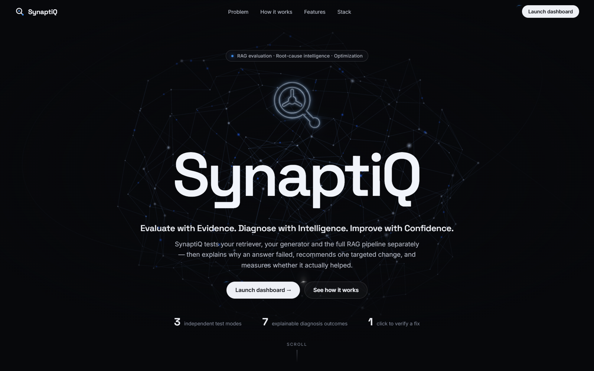
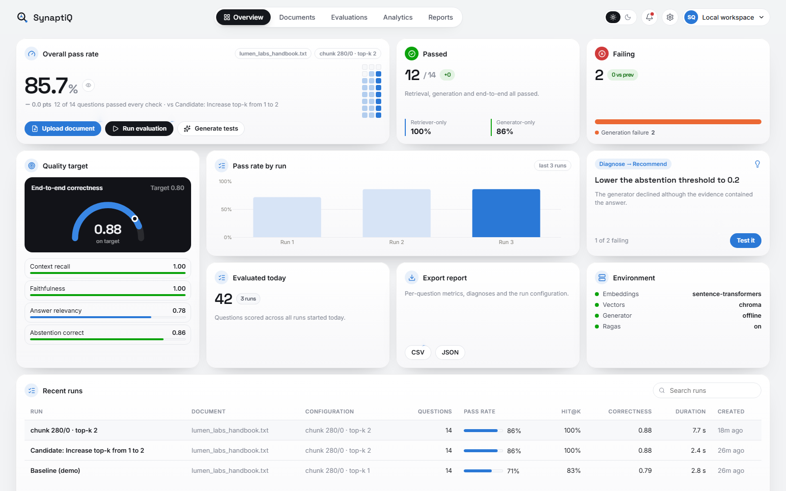
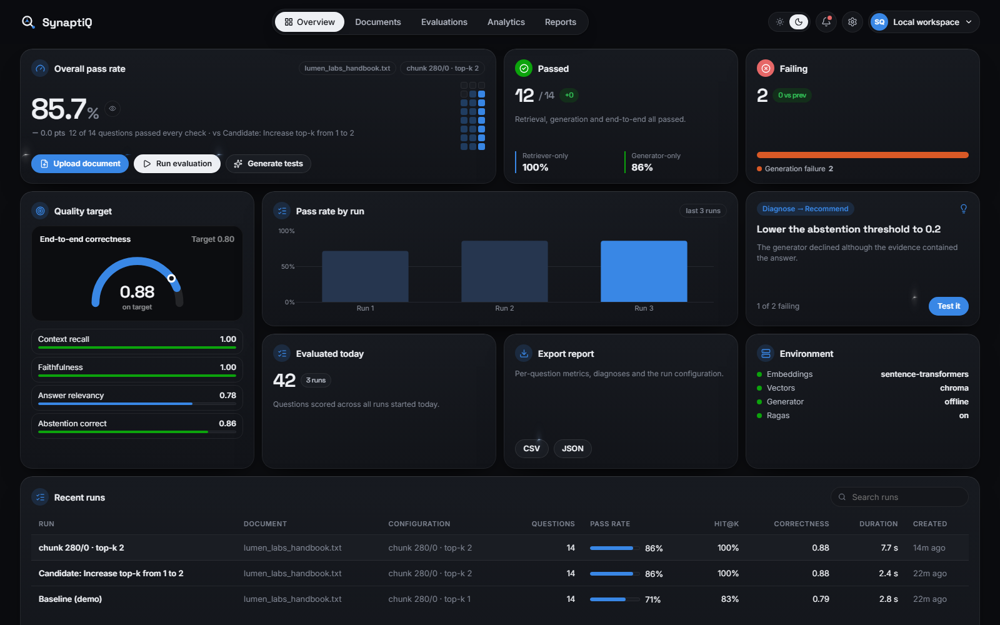
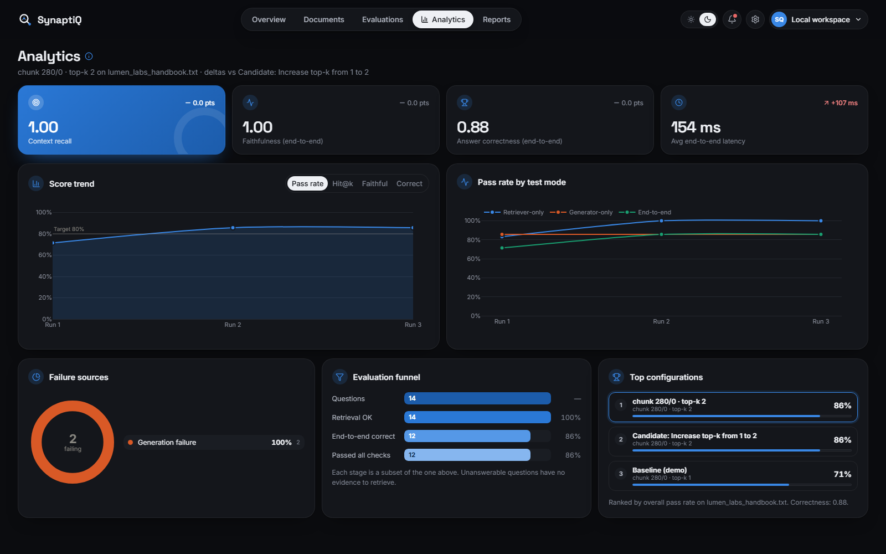

# SynaptiQ

<div align="center">

**RAG Evaluation, Root-Cause Intelligence, and Optimization**  
*Evaluate with Evidence. Diagnose with Intelligence. Improve with Confidence.*

[](https://www.python.org/)
[](https://react.dev/)
[](https://fastapi.tiangolo.com/)
[](https://streamlit.io/)
[](https://www.trychroma.com/)
[](LICENSE)
[](tests/)

</div>

---

## 📸 Visual Showcase

| 🌟 3D Cybernetic Landing Page | ☀️ Dashboard Overview (Light Mode) |
|---|---|
|  |  |
| **🌙 Dashboard Overview (Dark Mode)** | **📊 Deep Analytics & Radar Charts** |
|  |  |

---

## 📖 Table of Contents
1. [What is SynaptiQ? (Simple Explanation)](#-what-is-synaptiq-simple-explanation)
2. [The Real-World Problem We Solve](#-the-real-world-problem-we-solve)
3. [Key Features](#-key-features)
4. [How It Works (The 12-Step Pipeline in Plain English)](#-how-it-works-the-12-step-pipeline-in-plain-english)
5. [Quick Start (Install & Run in 3 Minutes)](#-quick-start-install--run-in-3-minutes)
6. [The 10-Second Demo](#-the-10-second-demo)
7. [Running the Application](#-running-the-application)
8. [The 3 Independent Test Modes](#-the-3-independent-test-modes)
9. [The 7 Root-Cause Diagnoses](#-the-7-root-cause-diagnoses)
10. [Transparent Evaluation Metrics (Explained Simply)](#-transparent-evaluation-metrics-explained-simply)
11. [Technology Stack](#-technology-stack)
12. [Project Structure](#-project-structure)
13. [Deep-Dive Documentation Index](#-deep-dive-documentation-index)
14. [Testing & Quality Assurance](#-testing--quality-assurance)
15. [Frequently Asked Questions (FAQ)](#-frequently-asked-questions-faq)
16. [Troubleshooting Common Issues](#-troubleshooting-common-issues)
17. [License](#-license)

---

## 💡 What is SynaptiQ? (Simple Explanation)

Imagine you work at a company and ask an AI assistant:  
> *"What is our company's policy on parental leave?"*

To answer your question from your company's documents, modern AI uses a system called **RAG** (**R**etrieval-**A**ugmented **G**eneration). 

Think of a RAG system like a team of two people working in a library:
1. **The Librarian (The Retriever)**: Searches through thousands of pages of your documents to find the exact paragraph about parental leave.
2. **The Writer (The Generator)**: Reads that paragraph and writes a friendly, clear, and accurate answer for you.

### What happens when the AI gives a wrong answer?
In most AI systems today, you only see the final wrong answer. **You have no idea who made the mistake:**
- Did the **Librarian** bring the wrong page from the bookshelf?
- Or did the **Librarian** bring the right page, but the **Writer** failed to read it properly and made something up (hallucination)?

### How SynaptiQ Solves This:
**SynaptiQ acts as an expert doctor for your AI system:**
- It tests the **Librarian** by itself.
- It tests the **Writer** by itself.
- It tests them **together**.
- When an answer is wrong, it tells you **exactly why** using real quotes from your source files.
- It recommends **one specific setting to change** (for example: *"Make your search top-k = 2 instead of 1"*).
- It tests the system again on the same questions to **prove** that the fix worked!

---

## 🎯 The Real-World Problem We Solve

Most AI evaluation tools only give you a vague score at the end, such as:  
> *"Overall System Score: 68%"*

This leaves developers and business teams completely lost:
- Should we make our text chunks bigger or smaller?
- Should we retrieve more documents?
- Is our search engine failing, or is the language model hallucinating?
- If we change a setting, did we accidentally break answers that were working before?

**SynaptiQ turns confusing scores into clear, actionable improvements:**
- **Evidence-Grounded**: Every measurement is linked to exact character locations in your original PDF, Word, or text files.
- **Explainable Diagnoses**: Every failure is sorted into one of 7 clear, plain-English categories.
- **Fair Benchmarks**: Tests before-and-after runs on the exact same questions so you can immediately see if any questions got worse (regressions).
- **100% Private & Free**: Runs completely on your own computer by default. No expensive GPU required, no API keys needed, and zero data leaves your machine.

---

## ✨ Key Features

- **🔬 3 Independent Test Modes**: Tests search, text generation, and the combined pipeline separately so you always know who made the mistake.
- **🩺 7 Plain-English Diagnoses**: Immediately separates retrieval misses from language model hallucinations, split text issues, and integration bugs.
- **⚡ 1-Click Targeted Fixes**: Recommends the single highest-impact parameter adjustment based on real evidence.
- **⚖️ Before-and-After Comparisons**: Directly compares your baseline system against your improved system and flags regressions.
- **🛡️ 100% Offline & Private**: Built-in offline text reader and local embedding model. No data is sent over the internet.
- **🌐 Dual-Host Architecture**: Run it as an interactive **Streamlit** workbench or as a production **FastAPI** web service with full REST endpoints.
- **🎨 Modern Web Experience**: A high-end React 19 interface featuring interactive 3D particle animations, sleek dark/light themes, and responsive dashboards.
- **🤖 Optional Claude Integration**: Connect Anthropic Claude with one click whenever you want high-level LLM answers and token cost tracking.

---

## 🔄 How It Works (The 12-Step Pipeline in Plain English)

Here is what happens under the hood when you use SynaptiQ:

```
[1. Upload File]        --> You upload a PDF, Word DOCX, or plain text file.
       │
[2. Character Map]      --> SynaptiQ maps every letter and page so evidence is never lost.
       │
[3. Clean Chunking]     --> Splits text into natural paragraphs without cutting sentences in half.
       │
[4. Smart Embeddings]   --> Converts text into mathematical vectors using a local AI model.
       │
[5. Local Vector Store] --> Stores vectors in ChromaDB on your hard drive for fast searching.
       │
[6. Test Set Creation]  --> Creates realistic questions with exact verbatim quotes as evidence.
       │
[7. Retriever Test]     --> Checks if the search engine finds the right document paragraphs.
       │
[8. Generator Test]     --> Hands the correct text to the writer to see if it can answer accurately.
       │
[9. Multi-Metric Score] --> Calculates recall, precision, faithfulness, and answer correctness.
       │
[10. Root-Cause Logic]  --> Sorts any failing questions into one of 7 clear diagnoses.
       │
[11. Targeted Advice]   --> Formulates 1 specific recommendation to fix the highest number of failures.
       │
[12. Verify & Report]   --> Re-tests on the same questions, verifies improvement, and exports reports.
```

---

## 🚀 Quick Start (Install & Run in 3 Minutes)

> **Important**: SynaptiQ is designed for **Python 3.11 or 3.12**. Please check your version by running `python --version` before you begin.

### Option A: Windows (PowerShell)

Open PowerShell and run these commands step by step:

```powershell
# 1. Download the project from GitHub
git clone https://github.com/amitsinghbhadouriya/SynaptiQ.git
cd SynaptiQ

# 2. Create an isolated Python environment
py -3.12 -m venv .venv
# (If using Python 3.11, use: py -3.11 -m venv .venv)

# 3. Activate the environment
.\.venv\Scripts\Activate.ps1
# (Note: If PowerShell says scripts are disabled, run:
# Set-ExecutionPolicy -Scope Process -ExecutionPolicy Bypass)

# 4. Install the required libraries
python -m pip install --upgrade pip
pip install -r requirements.txt

# 5. Launch the application!
streamlit run app.py
```

### Option B: macOS and Linux

Open your terminal and run:

```bash
# 1. Download the project from GitHub
git clone https://github.com/amitsinghbhadouriya/SynaptiQ.git
cd SynaptiQ

# 2. Create and activate an isolated Python environment
python3.12 -m venv .venv && source .venv/bin/activate
# (Or python3.11 -m venv .venv)

# 3. Install the required libraries
pip install --upgrade pip
pip install -r requirements.txt

# 4. Launch the application!
streamlit run app.py
```

Now open your web browser and visit **`http://localhost:8501`**!  
*(On your very first run, it will automatically download a tiny 90 MB local AI model. After that, it starts in under 2 seconds).*

> 💡 **Tip to save disk space and speed up install**: If you do not have an NVIDIA GPU, you can install the lightweight CPU-only PyTorch first:  
> `pip install torch --index-url https://download.pytorch.org/whl/cpu`

---

## ⏱️ The 10-Second Demo

Want to see how SynaptiQ works without setting up anything new? Try the built-in demo:

1. Open **`http://localhost:8501`** in your browser.
2. Click the bright **"Launch Dashboard →"** button.
3. At the top of the dashboard, click **"Load demo workspace"**.
4. **Watch what happens automatically:**
   - SynaptiQ loads the included *Lumen Labs Employee Handbook*.
   - It runs an initial test with a deliberately narrow search setting (chunk size 280, top-$k$ 1).
   - It analyzes the failures and recommends: *"Increase top-k from 1 to 2"*.
   - It runs the candidate fix on the exact same questions.
5. **The Result**: The pass rate jumps from **71% to 86%**! You will see 2 questions turn from red to green, with zero regressions.

---

## 🖥️ Running the Application

SynaptiQ gives you three simple ways to run:

| Command | What It Runs | Where to View |
|---|---|---|
| `streamlit run app.py` | **Main Application**: Full landing page, interactive dashboard, and Python Workbench. | Open `http://localhost:8501` |
| `uvicorn backend.api:app --reload` | **FastAPI Web Service**: High-speed REST API endpoints + built web application. | Open `http://localhost:8000` (API docs at `/docs`) |
| `pytest` | **Automated Tests**: 61 built-in offline unit and integration tests. | In your terminal |

> **Single-Process Safety**: SQLite and ChromaDB keep safe locks on the `./storage/` folder. Please run either Streamlit or FastAPI at one time (or specify different storage paths if running both simultaneously).

---

## 🔬 The 3 Independent Test Modes

To find out where an error comes from, SynaptiQ tests each component in isolation:

| Test Mode | Everyday Analogy | What It Tests | The Question Answered |
|---|---|---|---|
| **1. Retriever-Only** | *Testing the Librarian* | Document $\to$ Chunks $\to$ Search | Did the search engine find the paragraph that contains the answer? |
| **2. Generator-Only** | *Testing the Writer* | Known Evidence $\to$ Answer | If we hand the AI the exact right page, can it write an accurate answer without making things up? |
| **3. End-to-End** | *Testing the Team Together* | Question $\to$ Retriever $\to$ Generator | When the search engine and language model work together on their own, is the final answer correct? |

---

## 🩺 The 7 Root-Cause Diagnoses

Whenever an answer fails, SynaptiQ diagnoses the exact problem:

| Outcome Code | Plain English Meaning | What Happened? | How to Fix It |
|---|---|---|---|
| **`PASS`** | Everything Worked | Both search and answer generation succeeded. | No change needed. Your system is working properly. |
| **`LIKELY_RETRIEVAL_FAILURE`** | Search Missed the Clue | The generator can answer when given the text, but the search engine failed to find it. | Increase search results (top-$k$), make chunk sizes larger, or use better embeddings. |
| **`LIKELY_GENERATION_FAILURE`** | Generator Hallucinated | The search engine found the evidence, but the language model gave a wrong answer anyway. | Improve prompt instructions, lower temperature, or use a stronger model. |
| **`LIKELY_COMBINED_FAILURE`** | Both Failed | The search engine brought the wrong text, and the generator gave an incorrect answer. | Fix search first. You cannot generate a good answer without the right facts. |
| **`PIPELINE_INTERACTION_FAILURE`** | Too Much Clutter | Both work alone, but fail together when multiple paragraphs are packed into one long prompt. | Clean up context formatting, re-order chunks, or reduce token clutter. |
| **`CORRECT_BUT_UNGROUNDED`** | Lucky Guess | The AI guessed the right answer, but the search results did NOT contain the evidence! | Dangerous in production! Fix search so answers are backed by verified evidence. |
| **`UNCERTAIN_REQUIRES_REVIEW`** | Needs Human Eye | Metrics conflict or test data is incomplete. | Inspect the source document and question manually to verify formatting. |

---

## 📊 Transparent Evaluation Metrics (Explained Simply)

SynaptiQ does not use opaque, mysterious scores. Every metric is clearly explained:

- **Hit@k**: Did the top-$k$ search results include at least 50% of the reference evidence? (Yes or No).
- **Context Recall**: What percentage of the required evidence characters were found by the search engine?
- **Context Precision**: Did the most relevant chunks appear at the very top of the search list rather than buried at the bottom?
- **First Relevant Rank (MRR)**: At what position (#1, #2, #3...) did the first correct piece of evidence appear?
- **Answer Correctness**: Compares the AI's answer with the reference answer (65% word overlap + 35% semantic meaning). Numbers must match exactly.
- **Faithfulness**: Did the AI stick strictly to the retrieved facts, or did it introduce outside claims?
- **Abstention Correctness**: When a question cannot be answered from the document, did the AI honestly admit *"I cannot find that in the documents"* instead of making up a fake answer?

---

## 🛠️ Technology Stack

| Layer | Tools & Libraries | Purpose |
|---|---|---|
| **Frontend UI** | React 19, Vite, Three.js, GSAP | Fast modern web interface, 3D synapse animation, responsive bento grids. |
| **Design System** | Vanilla CSS, Space Grotesk, Inter, Lucide | Sleek dark/light theme, glassmorphism, animated cybernetic gradient on the letter "Q". |
| **Backend & APIs** | Streamlit, FastAPI, Uvicorn | Interactive Python Workbench, high-performance REST API, OpenAPI docs. |
| **Document Processing** | PyMuPDF (`fitz`), python-docx | High-fidelity text extraction with exact character position and page tracking. |
| **Vector Search** | ChromaDB, Sentence Transformers (`all-MiniLM-L6-v2`) | Local vector storage, fast cosine similarity search, smart hash caching. |
| **Evaluation Engine** | Custom Heuristics + Ragas Adapter | Offline string and semantic similarity metrics with zero external API calls. |
| **Database** | SQLite 3 | Reliable local relational storage for document runs, test sets, and before/after comparisons. |
| **Visualizations** | Plotly, pandas | Interactive radar charts, metric distributions, and one-click CSV/JSON exports. |
| **Testing** | pytest | 61 automated offline unit and integration tests for rock-solid stability. |

---

## 📁 Project Structure

Here is a quick map of the repository:

```text
SynaptiQ/
├── app.py                      # Streamlit application entry point
├── streamlit_ui/               # Streamlit host, custom component bridge, Workbench page
│   ├── component.py            # Bridge between React and Streamlit
│   ├── shared.py               # Shared session state and helpers
│   └── pages/                  # Landing, Dashboard, and Workbench views
├── backend/                    # Python core logic and pipeline
│   ├── api.py                  # FastAPI REST service & static web server
│   ├── service.py              # Main orchestrator workspace
│   ├── document_loader.py      # PDF, DOCX, and TXT parsing
│   ├── chunking.py             # Sentence-aware chunking with character offsets
│   ├── embeddings.py           # Local Sentence Transformers & vector hashing
│   ├── vector_store.py         # ChromaDB client & similarity search
│   ├── retriever.py            # Top-k retrieval & evidence coverage checks
│   ├── generator.py            # Local extractive generator & Claude API client
│   ├── metrics.py              # Mathematical evaluation scorers
│   ├── ragas_adapter.py        # String similarity and context recall
│   ├── root_cause.py           # 7-outcome deterministic diagnostic engine
│   ├── recommendations.py      # Evidence-derived parameter recommendations
│   ├── experiments.py          # Baseline vs Candidate comparison & regression analysis
│   ├── storage.py              # SQLite database for documents, runs, and results
│   ├── reports.py              # Pandas tables and report export generators
│   └── process_lock.py         # Single-process directory locking safety
├── frontend/                   # React 19 Single Page Application
│   ├── src/                    # Source JSX, components, styles
│   │   ├── landing/            # 10 self-contained landing sections
│   │   ├── dashboard/          # Overview, Documents, Evaluations, Analytics, Reports
│   │   ├── components/         # Three.js 3D SynapseScene, React Bits components
│   │   ├── bridge/             # Transport bridge (Streamlit + FastAPI transparent)
│   │   └── styles/             # Global CSS design tokens, cyber Q animations
│   └── dist/                   # Pre-compiled production bundle (ready to run)
├── data/                       # Bundled demo handbook and verified evaluation test set
├── docs/                       # 13 comprehensive markdown documentation guides
├── tests/                      # 61 automated pytest tests
├── requirements.txt            # Python dependencies
└── README.md                   # You are reading this!
```

---

## 📚 Deep-Dive Documentation Index

Want to learn more about specific parts of SynaptiQ? Check out our 13 detailed guides inside the [`docs/`](docs/) directory:

| Guide | What You Will Learn |
|---|---|
| [**Architecture Guide**](docs/architecture.md) | How the frontend, backend, dual hosts, and storage fit together. |
| [**Design System**](docs/design.md) | The colors, typography, glassmorphism, 3D canvas, and animations. |
| [**Database & Storage**](docs/database.md) | How SQLite tables, foreign keys, ChromaDB vectors, and locks work. |
| [**REST API Reference**](docs/api.md) | Complete list of all REST API endpoints with request and response examples. |
| [**Agents & Diagnostics**](docs/agents.md) | How the diagnostic engine, recommendation agent, and question generator work. |
| [**Project Implementation**](docs/project_implementation.md) | Step-by-step breakdown of the complete 12-stage engineering pipeline. |
| [**Setup & Installation**](docs/setup.md) | Step-by-step setup guides for Windows, macOS, Linux, and virtual environments. |
| [**Feature Development**](docs/feature_development.md) | How to add new document loaders, chunkers, metrics, or dashboard tabs. |
| [**Authentication & Security**](docs/authentication_and_security.md) | Privacy-by-design, local offline execution, and production deployment tips. |
| [**Integrations Guide**](docs/integration.md) | How to connect Claude, OpenAI, Ollama, LangChain, or custom RAG pipelines. |
| [**Testing & QA**](docs/testing_and_qa.md) | Overview of the 61 automated tests, running pytest, and test coverage. |
| [**Debugging & Troubleshooting**](docs/debugging.md) | Step-by-step solutions for database locks, port conflicts, and common errors. |
| [**Docs Overview**](docs/readme.md) | Quick overview and table of contents of the entire documentation suite. |

---

## 🧪 Testing & Quality Assurance

SynaptiQ includes **61 automated tests** that run 100% offline without needing internet access, model downloads, or paid API keys.

To run the test suite:

```bash
# Run all tests
pytest

# Run tests with detailed step-by-step progress
pytest -v

# Run only the diagnostic root-cause tests
pytest tests/test_root_cause.py -v
```

---

## 💬 Frequently Asked Questions (FAQ)

### 1. Do I need an OpenAI API key or an expensive GPU?
**No.** SynaptiQ runs 100% locally and completely free on any standard laptop CPU. It includes a built-in extractive answer generator and a fast, compact local embedding model.

### 2. Can I use my own company documents?
**Yes.** You can upload your own PDF (`.pdf`), Microsoft Word (`.docx`), or plain text (`.txt`) documents directly through the web dashboard.

### 3. Is my data kept private?
**Yes, 100%.** By default, zero data leaves your machine. SynaptiQ contains no telemetry, no tracking, and makes no hidden cloud calls.

### 4. Can I use Anthropic Claude if I want to?
**Yes.** If you want advanced LLM answers, simply paste your Anthropic API key in the dashboard or set `ANTHROPIC_API_KEY` in your `.env` file. SynaptiQ will track the token costs and generation latency automatically.

### 5. What if I want to connect SynaptiQ to my own external RAG system?
**Easily done!** You can use our clean FastAPI REST endpoints (documented at `http://localhost:8000/docs`) or use our Python SDK directly. See [docs/integration.md](docs/integration.md) for complete code examples.

---

## 🔧 Troubleshooting Common Issues

### 1. `pip install` fails with compilation or wheel errors
- **Cause**: You might be using Python 3.13 or newer, where pre-built wheels for machine learning libraries like `torch` or `chromadb` are not yet available.
- **Solution**: Install and use **Python 3.11 or 3.12**:
  ```powershell
  py -3.12 -m venv .venv
  .\.venv\Scripts\Activate.ps1
  pip install -r requirements.txt
  ```

### 2. "Another SynaptiQ process is already using ./storage"
- **Cause**: SQLite and ChromaDB prevent data corruption by allowing only one process to access the storage directory at a time.
- **Solution**: Close any other terminal window running SynaptiQ. If you previously closed a terminal unexpectedly, simply delete the lock file:
  - On Windows: `Remove-Item .\storage\synaptiq.lock`
  - On Mac/Linux: `rm ./storage/synaptiq.lock`

### 3. Port 8501 is already in use
- **Cause**: Another service or previous session is using port 8501.
- **Solution**: Launch Streamlit on a different port:
  ```bash
  streamlit run app.py --server.port 8505
  ```

### 4. How do I make changes to the React frontend?
- **Cause**: The pre-built production website is already compiled into `frontend/dist/`.
- **Solution**: If you want to modify the React source code in `frontend/src/`:
  ```bash
  cd frontend
  npm install
  npm run build
  ```

### 5. `ConnectionResetError: [WinError 10054]` in `_call_connection_lost`
- **Cause**: On Windows, Python's default `ProactorEventLoop` raises `[WinError 10054]` when a browser tab, iframe, or WebSocket connection disconnects abruptly (such as when refreshing a page or navigating). This is a known, harmless Python standard library quirk on Windows.
- **Solution**: SynaptiQ includes an automatic patch in `backend/windows_patch.py` that intercepts and silences this error across Streamlit, FastAPI, and Uvicorn. If you run custom scripts, ensure you import `backend` or activate the project virtual environment:
  ```powershell
  .\.venv\Scripts\Activate.ps1
  ```

---

## 📄 License

This project is licensed under the **MIT License** - you are free to use, modify, and distribute it in personal and commercial projects.

---

<div align="center">

**Built with ❤️ for developers and teams who want reliable, transparent, and evidence-grounded AI systems.**  
*Questions or feedback? Feel free to open an issue or pull request on GitHub!*

</div>

### 6. SynaptiQ v1.1.0 Architecture Highlights
- **Hybrid Retrieval**: Dense vector embeddings fused with BM25 lexical search via Reciprocal Rank Fusion ($k=60$).
- **Sliding-Window Rate Limiting**: Production-grade 30 req/min anti-abuse throttling.
- **Hallucination Diagnostics**: Fine-grained claim extraction and citation verification.
- **Telemetry & Metrics**: OpenTelemetry W3C trace context propagation and Prometheus endpoint.

### 6. SynaptiQ v1.1.0 Architecture Highlights
- **Hybrid Retrieval**: Dense vector embeddings fused with BM25 lexical search via Reciprocal Rank Fusion ($k=60$).
- **Sliding-Window Rate Limiting**: Production-grade 30 req/min anti-abuse throttling.
- **Hallucination Diagnostics**: Fine-grained claim extraction and citation verification.
- **Telemetry & Metrics**: OpenTelemetry W3C trace context propagation and Prometheus endpoint.
